I'm a backend developer focused on building maintainable services, designing reliable APIs, and turning ideas into practical software. My day-to-day work is TypeScript, NestJS and backend development, with an emphasis on data-driven applications and reliable database interactions.

Beyond my main stack, I build automation tools and Telegram bots with Python, and I like getting hands-on with the tools and environments that power modern applications.

 

**Stack** &nbsp; TypeScript · JavaScript · NestJS · PostgreSQL · Prisma
**Also** &nbsp;&nbsp; Python · C++ · Git · Docker · Postman

 

**Interests**

- Maintainable backend systems and well-structured APIs
- Database design, data modeling, and efficient data access
- Automation, scripting, and solving problems with Python
- Developer workflows, infrastructure, and server-side environments

 

**Projects**

More coming soon. Everything public lives in [repositories](https://github.com/ArsManTech?tab=repositories).
